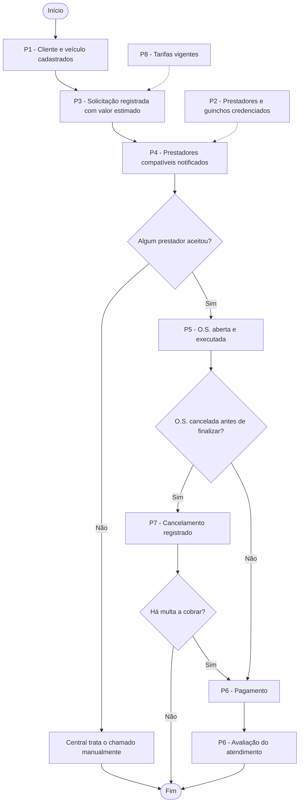
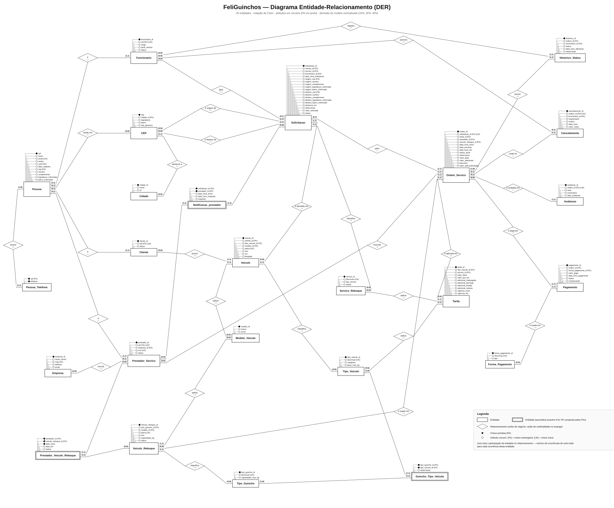

# Projeto ERP - Feliguinchos

## 1. Identificação do projeto

| Item | Descrição |
|---|---|
| Projeto | Feliguinchos, aplicativo de guincho e auto socorro que liga o cliente ao prestador (guincheiro) |
| Disciplina | Projeto Integrador de Modelagem de Dados |
| Banco de dados | `feliguinchos`, em MariaDB 10.4+ (XAMPP) ou MySQL 8.0.16+ |
| Repositório | https://github.com/felipedias1105-bot/feliguinchos |

A Feliguinchos é uma empresa fictícia, criada pelo grupo para este projeto.

Organização das pastas:

```
README.md          documentação geral do projeto
docs/
  diagramas/       DER (svg e pdf)
  documentacao/    Modelo Lógico e Modelo Físico
  normalizacao/    modelo de tabelas normalizado (1FN, 2FN e 3FN)
  requisitos/      requisitos funcionais e não funcionais
sql/
  README.md        como rodar os scripts
  ddl/             tabelas, gatilhos e views
  dados/           massa de dados
  consultas/       select, join, gerenciais, update e delete
  auditoria/       consultas de auditoria e testes de integridade
apresentacao/
evidencias/
```

---

## 2. Integrantes

| Integrante | RGM |
|---|---|
| Alexander Serafim | 049269569 |
| Anthony Gabriel Pereira Dos Santos | 49353411 |
| Arthur Kassab Dias | 47137621 |
| David Oliveira Dos Santos | 47235179 |
| Enzo Veríssimo | 47242493 |
| Evandro Araujo Costa | 47300761 |
| Felipe Dias Gomes | 48814342 |
| Felipe Gabriel Evangelista Alexandrias | 47251735 |
| Gabriel Da Silva | 47771526 |
| Guilherme Santos Peixoto Muniz | 46924507 |
| João Vitor Rocha Silva | 47170867 |
| Pablo Soares Gomes | 49150308 |

---

## 3. Empresa e problema

### 3.1 A empresa

A Feliguinchos é um aplicativo de guincho e auto socorro. A ideia é parecida com a de um aplicativo de transporte: o cliente que está com o veículo parado faz o pedido pelo app, o pedido vai para os prestadores (guincheiros) cadastrados e o primeiro que aceitar faz o atendimento.

A Feliguinchos não tem guinchos próprios. Quem faz o serviço são os prestadores, que podem ser guincheiros autônomos ou trabalhar para uma empresa parceira, e usam os próprios guinchos. A Feliguinchos cuida do aplicativo, das regras de preço, do cadastro e aprovação dos prestadores e do controle dos pagamentos.

Os serviços oferecidos são reboque urbano, reboque em rodovia, reboque de moto, socorro mecânico leve, troca de pneu, carga de bateria e pane seca.

| Quem participa | O que faz no aplicativo |
|---|---|
| Cliente | Cadastra seus veículos, pede o serviço, acompanha o atendimento, paga e avalia |
| Prestador (guincheiro) | Se cadastra com seus guinchos, recebe os pedidos compatíveis, aceita ou recusa e atualiza cada etapa do atendimento |
| Empresa parceira | Empresa de guincho que tem prestadores e guinchos cadastrados na plataforma |
| Equipe da Feliguinchos | Atendentes abrem pedidos para quem liga em vez de usar o app, o financeiro confere os pagamentos e o gerente aprova prestadores, define as tarifas e resolve cancelamentos |

### 3.2 O problema

Hoje, quem precisa de um guincho normalmente procura na internet ou pede indicação, liga para vários números e combina o preço na hora. Do outro lado, muitos guincheiros autônomos dependem de indicação e de grupos de WhatsApp para conseguir serviço. Nos dois lados quase nada fica registrado.

| Problema | Consequência |
|---|---|
| O cliente não sabe quem chamar | Demora para conseguir atendimento, principalmente de madrugada ou na estrada |
| Preço combinado na hora, sem tabela | Valores diferentes pelo mesmo serviço e desconfiança do cliente |
| Não dá para saber se o guincho serve para o veículo | Chega um guincho errado, por exemplo um guincho leve para uma van |
| Não dá para saber se o guincheiro tem documentos em dia | Risco para o cliente |
| O cliente não acompanha o atendimento | Não sabe se o guincho já saiu nem quando vai chegar |
| Pedido combinado por ligação ou WhatsApp | Nada fica registrado, nem quem recusou o serviço |
| Sem regra de cancelamento | O guincheiro perde o deslocamento e há discussão com o cliente |
| Pagamento direto em dinheiro ou Pix, sem comprovante | Não há controle do que foi pago |
| Nenhuma avaliação do serviço | Não dá para saber quem atende bem |
| O guincheiro não tem controle dos próprios serviços | Não sabe quanto atendeu nem quanto recebeu no mês |

---

## 4. Solução proposta

A solução é o aplicativo Feliguinchos, com um banco de dados único que guarda o cadastro de clientes e prestadores, os pedidos, os atendimentos, os pagamentos e as avaliações. O cliente vê o preço antes de confirmar, o pedido só vai para guincheiros aprovados e com guincho compatível, cada etapa fica registrada e a equipe da Feliguinchos acompanha tudo pelos relatórios.

Escolhemos esse tema porque o processo tem etapas bem definidas (pedido, envio aos prestadores, execução, pagamento e avaliação) e situações que exigem uma modelagem mais cuidadosa, como relacionamentos N:N com atributos, preços que mudam com o tempo e regras de cancelamento.

O centro do modelo é a Ordem de Serviço. É nela que se juntam cliente, veículo, prestador, guincho, tarifa, histórico, pagamento, cancelamento e avaliação.

### 4.1 Processos

| Código | Processo | O que fica registrado | Resultado |
|---|---|---|---|
| P1 | Cadastro de cliente e veículo | Pessoa, cliente, telefones, endereço e veículo | Cliente pode pedir atendimento |
| P2 | Credenciamento | Prestador, empresa parceira, guincho e vínculo prestador-guincho | Prestador liberado para receber chamados |
| P3 | Solicitação | Veículo, serviço, origem, destino e valor estimado pela tarifa vigente | Solicitação aguardando prestador |
| P4 | Despacho | Notificação para cada prestador compatível e a resposta dele | O.S. aberta no primeiro aceite |
| P5 | Execução | Cada mudança de status no histórico da O.S. | O.S. finalizada |
| P6 | Pagamento e avaliação | Tentativas de pagamento e nota de 1 a 5 | O.S. paga e avaliada |
| P7 | Cancelamento | Quem cancelou, motivo, multa e funcionário que autorizou | O.S. cancelada |
| P8 | Manutenção de tarifas | Nova tarifa com vigência, encerrando a anterior | Preço novo sem mexer nas O.S. abertas |

### 4.2 Fluxo geral



---

## 5. Requisitos e regras de negócio

O documento completo dos requisitos está em [docs/requisitos/FeliGuinchos_RF_RNF_Corrigido.pdf](docs/requisitos/FeliGuinchos_RF_RNF_Corrigido.pdf).

### 5.1 Requisitos funcionais

| Código | Requisito |
|---|---|
| RF01 | Cadastro de clientes, pessoas físicas e empresas |
| RF02 | Cadastro de prestadores, guinchos e situação de aprovação |
| RF03 | Cadastro de veículos dos clientes e veículos de reboque |
| RF04 | Cadastro, consulta, alteração e desativação dos serviços |
| RF05 | Registro da solicitação com solicitante, veículo, serviço, origem e destino |
| RF06 | Cálculo do valor estimado e do valor final pela tarifa e pelos adicionais |
| RF07 | Verificação de disponibilidade, aprovação e compatibilidade do guincho |
| RF08 | Envio da solicitação aos prestadores, registrando cada notificação |
| RF09 | Aceite ou recusa pelo prestador, sem dois aceites na mesma solicitação |
| RF10 | Abertura da O.S. só depois de um aceite válido |
| RF11 | Atualização do status da O.S. com histórico |
| RF12 | Acompanhamento da solicitação e da O.S. pelo cliente |
| RF13 | Registro da conclusão, sem a O.S. finalizada voltar a um status anterior |
| RF14 | Histórico de solicitações, O.S., notificações, status e cancelamentos |
| RF15 | Uma avaliação por O.S. concluída, com nota de 1 a 5 |
| RF16 | Controle de cancelamentos com responsável, motivo e multa |
| RF17 | Controle financeiro de pagamentos, formas de pagamento e repasses |
| RF18 | Relatórios operacionais e financeiros por período |
| RF19 | Controle dos documentos dos prestadores |
| RF20 | Controle da disponibilidade dos prestadores |
| RF21 | Indicadores financeiros como faturamento mensal e ticket médio |

### 5.2 Requisitos não funcionais

| Código | Tipo | Requisito |
|---|---|---|
| RNF01 | Segurança | Autenticação e senhas guardadas como hash |
| RNF02 | Controle de acesso | Acesso conforme o perfil de cada conta |
| RNF03 | Privacidade | Dados pessoais tratados conforme a LGPD |
| RNF04 | Registro das operações | Registro de quem fez cada operação, com data e hora |
| RNF05 | Desempenho | Tempo das consultas medido em teste |
| RNF06 | Disponibilidade | Funcionamento 24 horas, com monitoramento |
| RNF07 | Confiabilidade | Dados de solicitações, O.S. e pagamentos consistentes mesmo com falhas |
| RNF08 | Usabilidade | Telas adequadas para cliente, prestador e equipe da Feliguinchos |
| RNF09 | Integridade | Restrições no banco para impedir dados inválidos |
| RNF10 | Rastreabilidade | Saber quem alterou cada registro e em que ordem |
| RNF11 | Backup | Cópias periódicas com teste de restauração |
| RNF12 | Tempo de resposta | Monitorar o tempo de envio das solicitações aos prestadores |
| RNF13 | Controle por perfil | Permissões diferentes para cada tipo de usuário |
| RNF14 | Integração | Cadastro, solicitações, O.S. e financeiro na mesma base |

### 5.3 Regras de negócio

Clientes, prestadores e guinchos:

- CPF, e-mail, CNPJ e placa não podem se repetir, e toda pessoa precisa ter pelo menos um telefone.
- Uma mesma pessoa pode ser cliente, funcionário e prestador sem precisar ser cadastrada de novo.
- O prestador pode ser autônomo ou ligado a uma única empresa parceira. Ele só fica ATIVO com a CNH preenchida.
- Um prestador pode operar vários guinchos e um guincho pode passar por vários prestadores. Cada vínculo tem data de início e de fim.
- A compatibilidade é definida entre tipo de guincho e tipo de veículo. Todo tipo de veículo precisa ter pelo menos um tipo de guincho compatível, e a capacidade de um guincho não pode passar da capacidade do seu tipo.

Tarifas e solicitação:

- Cada tarifa vale para um tipo de veículo e um serviço, dentro de um período. Duas tarifas da mesma combinação não podem valer ao mesmo tempo.
- O valor estimado é calculado com a tarifa vigente e fica gravado, porque é o valor que foi passado ao cliente.
- A solicitação pode ser aberta pelo cliente no aplicativo ou por um atendente. Só cliente ATIVO pode pedir, e só serviço ATIVO pode ser pedido.
- Só prestadores ATIVOS recebem notificação. Cada solicitação tem no máximo um aceite e gera no máximo uma O.S.

Ordem de serviço:

- O prestador da O.S. tem que ser o que aceitou. O guincho tem que estar vinculado a ele na data e ser compatível com o veículo, e a tarifa tem que ser do mesmo tipo de veículo e serviço.
- Toda O.S. começa com o registro de aceite no histórico. A ordem dos status é ACEITA, A_CAMINHO, NO_LOCAL, EM_ATENDIMENTO e FINALIZADA. A O.S. pode ser cancelada em qualquer etapa antes de finalizar, e depois de finalizada não volta.
- Valor total = valor base + adicionais - desconto. O desconto não pode ser maior que o valor bruto.

Cancelamento, pagamento e avaliação:

- Cada O.S. cancelada tem no máximo um cancelamento, com quem cancelou (cliente, prestador ou a central, que é a equipe da Feliguinchos), motivo e multa. A isenção da multa precisa de autorização de um funcionário.
- Uma O.S. pode ter várias tentativas de pagamento, cada uma em uma forma (Pix, crédito, débito, dinheiro ou faturado em boleto para PJ).
- Só O.S. finalizada pode ser avaliada, uma vez, com nota de 1 a 5.
- O.S., pagamentos e cancelamentos não são apagados. As exclusões são bloqueadas nas chaves estrangeiras.

### 5.4 Regras implementadas no banco (R1 a R16)

Essas regras foram levantadas no Modelo Lógico e depois implementadas no banco.

| Regra | Descrição | Como foi feita |
|---|---|---|
| R1 | Nota de 1 a 5 | CHECK |
| R2 | Valores e distâncias maiores ou iguais a zero, valor pago maior que zero, desconto até o valor bruto | CHECK |
| R3 | Datas coerentes (fim depois do início, resposta depois do envio) | CHECK |
| R4 | Valores permitidos de status e perfil | CHECK |
| R5 | Prestador ATIVO precisa de CNH | CHECK |
| R6 | Só uma notificação ACEITA por solicitação | Coluna gerada `aceite_unico` com UNIQUE |
| R7 | O prestador da O.S. é o que aceitou | Gatilho |
| R8 | Só prestador ATIVO recebe notificação e O.S. | Gatilho |
| R9 | Guincho vinculado ao prestador e compatível com o veículo | Gatilho |
| R10 | Tarifa certa para o veículo e o serviço, vigente na data | Gatilho |
| R11 | Tarifas sem vigência sobreposta | Gatilho |
| R12 | Capacidade do guincho dentro da capacidade do tipo | Gatilho |
| R13 | Mínimos (1,N) do DER | Consulta de auditoria e teste |
| R14 | Toda O.S. começa com histórico de aceite | Gatilho |
| R15 | Ordem dos status e `status_atual` igual ao último histórico | Gatilho |
| R16 | Avaliação só de O.S. finalizada, cancelamento só de O.S. cancelada, solicitação só de cliente ativo | Gatilho |

---

## 6. DER atualizado

O DER foi refeito em notação de Chen a partir do modelo já normalizado. Ele tem 25 entidades, com as chaves e as cardinalidades (mínima, máxima).



Arquivos: [DER_FeliGuinchos.svg](docs/diagramas/DER_FeliGuinchos.svg) e [DER_FeliGuinchos.pdf](docs/diagramas/DER_FeliGuinchos.pdf).

Algumas decisões que tomamos no modelo:

- Separamos a Solicitação da Ordem de Serviço porque muitos pedidos não viram atendimento (o cliente desiste ou ninguém aceita). Assim também dá para saber quantos chamados foram perdidos.
- A notificação ficou como relacionamento N:N com atributos, porque a resposta (aceita, recusada ou expirada) é de cada par solicitação-prestador.
- O vínculo entre prestador e guincho guarda o período, para saber qual guincho ele usava em cada data.
- A compatibilidade é entre tipos, e não entre cada guincho e cada carro. Quando entra um guincho novo, basta informar o tipo.
- A tarifa tem vigência. Quando o preço muda, as O.S. já abertas continuam com a tarifa antiga.
- Além do status atual, a O.S. tem um histórico de status, que mostra quem mudou cada etapa e quando.
- Cancelamento e Avaliação são entidades separadas, já que a maioria das O.S. não tem cancelamento e algumas não são avaliadas.
- A Solicitação se liga ao Veículo, e o cliente é encontrado pelo veículo. Ligar direto ao cliente criaria dois caminhos que poderiam apontar para pessoas diferentes.
- O funcionário é opcional ao abrir solicitação, mudar status e autorizar cancelamento, porque o pedido pode vir do aplicativo e o status pode ser mudado pelo prestador.
- A entidade Pessoa reúne os dados comuns de clientes, funcionários e prestadores (ver seção 8).

---

## 7. Modelo lógico

Documento: [docs/documentacao/MODELO LOGICO.docx](docs/documentacao/MODELO%20LOGICO.docx). Ele é a versão pré-normalização, com 21 tabelas, e está marcado assim no início. A estrutura final, com 25 tabelas, está abaixo e no [Modelo Físico](docs/documentacao/Modelo_Fisico_Feliguinchos.pdf).

Regras que usamos para passar do DER para tabelas:

- Cada entidade virou uma tabela com chave primária numérica (`<tabela>_id`).
- Nos relacionamentos 1:N, a chave estrangeira fica no lado N. Ela aceita nulo quando o DER marca (0,1).
- Nos relacionamentos 1:1, a chave estrangeira fica na tabela dependente com UNIQUE (Ordem_Servico, Avaliacao e Cancelamento).
- Os relacionamentos N:N viraram tabelas associativas com chave composta.
- O telefone (multivalorado) ganhou tabela própria, o endereço (composto) foi separado em colunas e o valor total da O.S. (derivado) virou coluna calculada.
- Todas as chaves estrangeiras usam ON DELETE RESTRICT, menos a do telefone, que usa CASCADE.

A primeira versão do modelo lógico tinha 21 tabelas (17 entidades, 3 associativas e a tabela de telefone) e 27 chaves estrangeiras. Testamos essa versão em SQLite e as 30 verificações passaram. Depois da normalização (seção 8), o modelo ficou com 25 tabelas:

```
pessoa (cpf PK, nome, email UK, senha, cnpj UK, data_cadastro, cep FK, numero, complemento,
        logradouro_informado, bairro_informado)
pessoa_telefone (cpf PK FK, telefone PK)
cliente (cliente_id PK, cpf FK UK, status)
funcionario (funcionario_id PK, cpf FK UK, cargo, perfil_acesso, status)
empresa (empresa_id PK, razao_social, cnpj UK, telefone, email)
prestador_servico (prestador_id PK, cpf FK UK, empresa_id FK, cnh UK, status)
cidade (cidade_id PK, nome, uf)
cep (cep PK, cidade_id FK, logradouro, bairro, cep_generico)
modelo_veiculo (modelo_id PK, marca, nome)
tipo_veiculo (tipo_veiculo_id PK, descricao UK, categoria, peso_max_kg)
veiculo (veiculo_id PK, cliente_id FK, tipo_veiculo_id FK, modelo_id FK, placa UK, ano, cor, blindado)
tipo_guincho (tipo_guincho_id PK, descricao UK, capacidade_max_kg)
veiculo_reboque (veiculo_reboque_id PK, tipo_guincho_id FK, modelo_id FK, placa UK, ano,
                 capacidade_kg, status)
guincho_tipo_veiculo (tipo_guincho_id PK FK, tipo_veiculo_id PK FK, observacao)
prestador_veiculo_reboque (prestador_id PK FK, veiculo_reboque_id PK FK, data_inicio PK, data_fim, status)
servico_reboque (servico_id PK, descricao UK, tipo_servico, status)
tarifa (tarifa_id PK, tipo_veiculo_id FK, servico_id FK, valor_base, valor_por_km, adicional_madrugada,
        adicional_domingo, adicional_feriado, adicional_rodovia, vigencia_inicio, vigencia_fim)
solicitacao (solicitacao_id PK, veiculo_id FK, servico_id FK, funcionario_id FK, data_hora_solicitacao,
             origem_cep FK, origem_numero, origem_complemento, origem_logradouro_informado,
             origem_bairro_informado, destino_cep FK, destino_numero, destino_complemento,
             destino_logradouro_informado, destino_bairro_informado, distancia_km, observacao,
             valor_estimado, status)
notificacao_prestador (solicitacao_id PK FK, prestador_id PK FK, data_hora_envio, data_hora_resposta,
                       resposta, aceite_unico UK)
ordem_servico (ordem_id PK, solicitacao_id FK UK, tarifa_id FK, prestador_id FK, veiculo_reboque_id FK,
               data_hora_inicio, data_previsao, data_hora_fim, status_atual, observacao, valor_base,
               valor_adicionais, desconto, valor_total)
historico_status (historico_id PK, ordem_id FK, funcionario_id FK, status, data_hora_alteracao, observacao)
forma_pagamento (forma_pagamento_id PK, descricao UK, tipo)
pagamento (pagamento_id PK, ordem_id FK, forma_pagamento_id FK, valor_pago, data_hora_pagamento,
           status, comprovante)
avaliacao (avaliacao_id PK, ordem_id FK UK, nota, comentario, data_avaliacao)
cancelamento (cancelamento_id PK, ordem_id FK UK, funcionario_id FK, responsavel, motivo, data_hora,
              valor_multa)
```

Durante a conversão, comparamos o texto da primeira entrega com o DER e corrigimos 17 diferenças (C1 a C17). Por exemplo, a Empresa não aparecia no texto, a `distancia_km` estava repetida na O.S. e o `valor_total` era guardado em vez de calculado. Algumas regras citadas nos documentos não tinham onde ficar no DER, como documentos do prestador, aceite dos termos de uso, nota fiscal e repasse ao prestador. Essas ficaram anotadas como pendências (P1 a P14), sem criar tabelas por conta própria.

---

## 8. Normalização

Documento completo: [docs/normalizacao/Modelo de tabelas normalizado (1FN, 2FN e 3FN).pdf](docs/normalizacao/Modelo%20de%20tabelas%20normalizado%20%281FN%2C%202FN%20e%203FN%29%20%283%29.pdf). Responsável: Gabriel da Silva.

Partimos das 21 tabelas do modelo lógico e chegamos a 25: 4 tabelas novas (Pessoa, Cidade, CEP e Modelo_Veiculo), 8 alteradas e 13 que não mudaram. Abaixo estão as situações do projeto que levaram a essas mudanças, no formato estrutura analisada, dependências funcionais, problema e correção. Na notação, `X → Y` quer dizer "X determina Y".

### 8.1 Verificação das formas normais

| Forma normal | O que verificamos |
|---|---|
| 1FN | Nenhum campo guarda mais de um valor. O telefone já estava em tabela própria para o cliente, mas o prestador tinha uma coluna `telefone` só. Agora todos os telefones ficam em Pessoa_Telefone. O endereço foi dividido em colunas. |
| 2FN | Nas quatro tabelas com chave composta, os atributos dependem da chave inteira: `(prestador_id, veiculo_reboque_id, data_inicio) → data_fim, status`, `(tipo_guincho_id, tipo_veiculo_id) → observacao` e `(solicitacao_id, prestador_id) → data_hora_envio, data_hora_resposta, resposta`. Pessoa_Telefone não tem atributo fora da chave. Nenhuma dessas tabelas guarda dado que dependa de só uma parte da chave, como o nome do prestador. |
| 3FN | Procuramos atributos que dependiam de outro atributo, e não da chave. Os casos encontrados estão em 8.2 (endereço) e 8.5 (tarifa). Os casos 8.3 e 8.4 não eram violação de 3FN dentro de uma tabela, mas eram redundâncias entre tabelas, e foram corrigidos na mesma etapa. |

### 8.2 Endereço: CEP e Cidade

Antes:

```
CLIENTE(cliente_id, nome, cpf, email, senha, data_cadastro, status,
        logradouro, numero, complemento, bairro, cidade, uf, cep)
SOLICITACAO(solicitacao_id, ..., endereco_origem, endereco_destino, ...)
```

Dependências funcionais:

```
cliente_id → cep, numero, complemento
cep        → logradouro, bairro, cidade, uf
```

Problema: dependência transitiva. O logradouro, o bairro e a cidade não dependem do cliente, e sim do CEP (`cliente_id → cep → logradouro, bairro, cidade, uf`). Esses dados se repetiam em cada pessoa do mesmo CEP, e nada impedia que fossem digitados de jeitos diferentes, como "Vila Mariana" e "V. Mariana". Na massa de dados, a cliente Juliana e a funcionária Ana Paula moram no mesmo CEP (04101300). Na solicitação, origem e destino eram texto livre, então não dava para saber a cidade de um chamado.

Há uma exceção: em cidades com um único CEP (CEP genérico, como Juquitiba), vale só `cep → cidade, uf`. O logradouro e o bairro dependem da pessoa ou do chamado, e não do CEP, então ficaram na própria tabela como `logradouro_informado` e `bairro_informado`, preenchidos só nesse caso. O CHECK `ck_cep_generico` e o gatilho de endereço garantem isso.

A tabela Cidade não resolve uma transitiva: `cidade → uf` não vale, porque existem cidades com o mesmo nome em estados diferentes (Bom Jesus, por exemplo, existe no PI, no RS e em SC). Ela foi separada para padronizar o nome da cidade, do mesmo jeito que Tipo_Veiculo padroniza o tipo, e para permitir as consultas por cidade (C15 e C16).

Depois:

```
CIDADE(cidade_id, nome, uf)                         UNIQUE(nome, uf)
CEP(cep, cidade_id, logradouro, bairro, cep_generico)
PESSOA(..., cep, numero, complemento, logradouro_informado, bairro_informado)
SOLICITACAO(..., origem_cep, origem_numero, origem_complemento,
            origem_logradouro_informado, origem_bairro_informado,
            destino_cep, destino_numero, destino_complemento,
            destino_logradouro_informado, destino_bairro_informado, ...)
```

### 8.3 Pessoa: dados repetidos entre Cliente, Funcionário e Prestador

Antes:

```
CLIENTE(cliente_id, nome, cpf, email, senha, data_cadastro, status, logradouro, ...)
CLIENTE_TELEFONE(cliente_id, telefone)
FUNCIONARIO(funcionario_id, nome, cpf, email, cargo, perfil_acesso, senha, status)
PRESTADOR_SERVICO(prestador_id, empresa_id, nome, cpf, telefone, email, cnh, status, data_cadastro)
```

Dependências funcionais:

```
cpf            → nome, email, senha        (vale nas três tabelas)
cliente_id     → cpf, status
funcionario_id → cpf, cargo, perfil_acesso, status
prestador_id   → cpf, empresa_id, cnh, status
```

Problema: dentro de cada tabela não havia violação da 3FN, porque o `cpf` era chave candidata (único). O problema era a mesma dependência `cpf → nome, email, senha` guardada em três tabelas diferentes. Quando a mesma pessoa tem dois papéis, os dados dela ficam duplicados e podem ficar diferentes depois de uma alteração. Na massa de dados, Paulo Sérgio Ramos é prestador e também cliente. Além disso, o cliente podia ter vários telefones e o prestador só um.

Correção: generalização. Os atributos que dependem só do CPF foram para Pessoa, e cada papel ficou só com o que é dele. O `cpf` UNIQUE em Cliente, Funcionario e Prestador_Servico garante que cada pessoa tenha no máximo um registro de cada papel.

Depois:

```
PESSOA(cpf, nome, email, senha, cnpj, data_cadastro,
       cep, numero, complemento, logradouro_informado, bairro_informado)
PESSOA_TELEFONE(cpf, telefone)
CLIENTE(cliente_id, cpf, status)
FUNCIONARIO(funcionario_id, cpf, cargo, perfil_acesso, status)
PRESTADOR_SERVICO(prestador_id, cpf, empresa_id, cnh, status)
```

### 8.4 Modelo_Veiculo: marca e modelo repetidos em duas tabelas

Antes:

```
VEICULO(veiculo_id, cliente_id, tipo_veiculo_id, placa, marca, modelo, ano, cor, blindado)
VEICULO_REBOQUE(veiculo_reboque_id, tipo_guincho_id, placa, marca, modelo, ano, capacidade_kg, status)
```

Dependências funcionais:

```
veiculo_id         → marca, modelo
veiculo_reboque_id → marca, modelo
(marca, modelo)      identifica um modelo de veículo
```

Problema: o nome do modelo sozinho não determina a marca. "Express", por exemplo, é nome de van da Chevrolet e da Renault. Por isso não consideramos `modelo → marca`, e não havia dependência transitiva dentro de cada tabela. O problema era que o par marca e modelo descreve outra coisa, o modelo, e era digitado de novo em cada veículo e em cada guincho. "Fiat Strada", "FIAT Strada" e "Strada" seriam aceitos como modelos diferentes, e não dava para saber que um carro de cliente e um guincho são do mesmo modelo. Na massa de dados, o Fiat Strada aparece nos dois.

Correção: o modelo virou uma tabela própria, identificada pelo par (marca, nome). Por isso a restrição única é composta. Veiculo e Veiculo_Reboque passaram a apontar para ela.

Depois:

```
MODELO_VEICULO(modelo_id, marca, nome)              UNIQUE(marca, nome)
VEICULO(veiculo_id, cliente_id, tipo_veiculo_id, modelo_id, placa, ano, cor, blindado)
VEICULO_REBOQUE(veiculo_reboque_id, tipo_guincho_id, modelo_id, placa, ano, capacidade_kg, status)
```

### 8.5 Tarifa: status deduzido da vigência

Antes:

```
TARIFA(tarifa_id, tipo_veiculo_id, servico_id, valor_base, valor_por_km,
       adicional_madrugada, adicional_domingo, adicional_feriado, adicional_rodovia,
       vigencia_inicio, vigencia_fim, status)
```

Dependências funcionais:

```
tarifa_id   → vigencia_inicio, vigencia_fim, status
vigencia_fim → status      (ENCERRADA se a data já passou; ATIVA se é nula ou futura)
```

Problema: dependência transitiva. O status não depende diretamente da tarifa, e sim da data de fim da vigência (`tarifa_id → vigencia_fim → status`). Se ninguém atualizar o status no dia em que a vigência termina, o banco fica com uma tarifa vencida marcada como ATIVA, ou com duas tarifas ATIVAS para o mesmo tipo de veículo e serviço. Na massa de dados, a tarifa 12 (automóvel, reboque urbano) terminou em 31/12/2025 e foi substituída pela tarifa 1.

Correção: a coluna status foi removida. A tarifa vigente é encontrada pela data (`vigencia_inicio <= hoje` e `vigencia_fim` nula ou `>= hoje`), como na consulta A8 de `01_select.sql`. O gatilho R11 impede vigências sobrepostas.

Depois:

```
TARIFA(tarifa_id, tipo_veiculo_id, servico_id, valor_base, valor_por_km,
       adicional_madrugada, adicional_domingo, adicional_feriado, adicional_rodovia,
       vigencia_inicio, vigencia_fim)
```

### 8.6 Redundâncias mantidas

Mantivemos de propósito três dados que poderiam ser calculados: o `status_atual` da O.S. (o gatilho R15 garante que ele é igual ao último histórico), o `valor_estimado` da solicitação (é o que foi prometido ao cliente) e o `valor_multa` do cancelamento (pode ter havido isenção).

---

## 9. Dicionário de Dados

### 9.1 Pessoa

| Atributo | Descrição | Tipo | Tam. | Restrição | DEFAULT | Regra |
| --- | --- | --- | --- | --- | --- | --- |
| cpf | CPF da pessoa. Identifica a pessoa em todo o sistema. | CHAR | 11 | PK, UK, NOT NULL | — | Somente dígitos. |
| nome | Nome completo da pessoa. | VARCHAR | 100 | NOT NULL | — | Obrigatório (RN01). |
| email | E-mail de contato e acesso. | VARCHAR | 120 | UK, NOT NULL | — | Não pode repetir (RN01). |
| senha | Senha de acesso, guardada de forma criptografada. | VARCHAR | 255 | NOT NULL | — | Guardar o hash, nunca a senha em texto (RN01, RNF01). |
| cnpj | CNPJ da pessoa quando ela atua como pessoa jurídica. | CHAR | 14 | UK, NULL | — | Somente dígitos. Opcional: preenchido só quando a pessoa atua como pessoa jurídica. |
| data_cadastro | Data em que a pessoa foi cadastrada. | DATE | — | NOT NULL | CURRENT_DATE | Padrão: data do cadastro. |
| cep | CEP do endereço da pessoa. | CHAR | 8 | FK, NULL | — | FK → CEP.cep. Opcional (P14). |
| numero | Número do endereço. | VARCHAR | 10 | NULL | — | Opcional. |
| complemento | Complemento do endereço. | VARCHAR | 60 | NULL | — | Opcional. |
| logradouro_informado | Rua informada pela pessoa quando o CEP não tem logradouro próprio. | VARCHAR | 120 | NULL | — | Obrigatório se o CEP for genérico; senão, nulo. |
| bairro_informado | Bairro informado pela pessoa quando o CEP não tem bairro próprio. | VARCHAR | 60 | NULL | — | Obrigatório se o CEP for genérico; opcional nos demais. |


### 9.2 Pessoa_Telefone

| Atributo | Descrição | Tipo | Tam. | Restrição | DEFAULT | Regra |
| --- | --- | --- | --- | --- | --- | --- |
| cpf | Pessoa dona do telefone. | CHAR | 11 | PK, FK, NOT NULL | — | PK e FK → Pessoa.cpf. Uma pessoa pode ter vários telefones. |
| telefone | Telefone de contato. | VARCHAR | 15 | PK, NOT NULL | — | PK (junto com cpf). DDD + número, só dígitos. O cadastro exige telefone (RN01). |


### 9.3 Cliente

| Atributo | Descrição | Tipo | Tam. | Restrição | DEFAULT | Regra |
| --- | --- | --- | --- | --- | --- | --- |
| cliente_id | Identificador do cliente. | INTEGER | — | PK, UK, NOT NULL | Auto incremento | Gerado pelo sistema. |
| cpf | Pessoa que é o cliente. | CHAR | 11 | FK, UK, NOT NULL | — | FK → Pessoa.cpf. UK: uma pessoa é no máximo um cliente. |
| status | Situação do cliente na plataforma. | VARCHAR | 10 | NOT NULL | — | Valores: ATIVO, PENDENTE ou BLOQUEADO (RN16). |


### 9.4 Funcionario

| Atributo | Descrição | Tipo | Tam. | Restrição | DEFAULT | Regra |
| --- | --- | --- | --- | --- | --- | --- |
| funcionario_id | Identificador do funcionário. | INTEGER | — | PK, UK, NOT NULL | Auto incremento | Gerado pelo sistema. |
| cpf | Pessoa que é o funcionário. | CHAR | 11 | FK, UK, NOT NULL | — | FK → Pessoa.cpf. UK: uma pessoa é no máximo um funcionário. |
| cargo | Cargo do funcionário. | VARCHAR | 50 | NOT NULL | — |  |
| perfil_acesso | Perfil de acesso ao sistema. | VARCHAR | 10 | NOT NULL | — | Valores: ATENDENTE, FINANCEIRO ou GERENTE (RNF02, RNF13). |
| status | Situação do funcionário. | VARCHAR | 10 | NOT NULL | — | Valores: ATIVO ou INATIVO. |


### 9.5 Empresa

| Atributo | Descrição | Tipo | Tam. | Restrição | DEFAULT | Regra |
| --- | --- | --- | --- | --- | --- | --- |
| empresa_id | Identificador da empresa. | INTEGER | — | PK, UK, NOT NULL | Auto incremento | Gerado pelo sistema. |
| razao_social | Razão social da empresa. | VARCHAR | 150 | NOT NULL | — |  |
| cnpj | CNPJ da empresa. | CHAR | 14 | UK, NOT NULL | — | Somente dígitos. Não pode repetir. |
| telefone | Telefone da empresa. | VARCHAR | 15 | NULL | — | Opcional (P5). |
| email | E-mail da empresa. | VARCHAR | 120 | NULL | — | Opcional (P5). |


### 9.6 Prestador_Servico

| Atributo | Descrição | Tipo | Tam. | Restrição | DEFAULT | Regra |
| --- | --- | --- | --- | --- | --- | --- |
| prestador_id | Identificador do prestador. | INTEGER | — | PK, UK, NOT NULL | Auto incremento | Gerado pelo sistema. |
| cpf | Pessoa que é o prestador. | CHAR | 11 | FK, UK, NOT NULL | — | FK → Pessoa.cpf. UK: uma pessoa é no máximo um prestador. |
| empresa_id | Empresa à qual o prestador é vinculado. | INTEGER | — | FK, NULL | — | FK → Empresa.empresa_id. Opcional. |
| cnh | Número da CNH do motorista. | VARCHAR | 11 | UK, NULL | — | Obrigatória para status ATIVO (RN22). Não pode repetir. |
| status | Situação do cadastro do prestador. | VARCHAR | 10 | NOT NULL | 'EM_ANALISE' | Valores: EM_ANALISE, ATIVO, RECUSADO ou BLOQUEADO. Só o administrador aprova (RN22). |


### 9.7 Cidade

| Atributo | Descrição | Tipo | Tam. | Restrição | DEFAULT | Regra |
| --- | --- | --- | --- | --- | --- | --- |
| cidade_id | Identificador da cidade. | INTEGER | — | PK, UK, NOT NULL | Auto incremento | Gerado automaticamente. |
| nome | Nome da cidade. | VARCHAR | 60 | UK, NOT NULL | — | UK composta (nome, uf). |
| uf | Sigla do estado. | CHAR | 2 | UK, NOT NULL | — | UK composta (nome, uf). |


### 9.8 CEP

| Atributo | Descrição | Tipo | Tam. | Restrição | DEFAULT | Regra |
| --- | --- | --- | --- | --- | --- | --- |
| cep | Código de endereçamento postal. | CHAR | 8 | PK, UK, NOT NULL | — | Somente dígitos. |
| cidade_id | Cidade do CEP. | INTEGER | — | FK, NOT NULL | — | FK → Cidade.cidade_id. |
| logradouro | Rua do CEP. | VARCHAR | 120 | NULL | — | Nulo quando o CEP é genérico; obrigatório nos demais. |
| bairro | Bairro do CEP. | VARCHAR | 60 | NULL | — | Nulo quando o CEP é genérico. |
| cep_generico | Indica se o CEP é único da cidade, sem logradouro próprio. | BOOLEAN | — | NOT NULL | FALSE | Padrão FALSO. Verdadeiro: CEP único da cidade, sem logradouro próprio. |


### 9.9 Modelo_Veiculo

| Atributo | Descrição | Tipo | Tam. | Restrição | DEFAULT | Regra |
| --- | --- | --- | --- | --- | --- | --- |
| modelo_id | Identificador do modelo. | INTEGER | — | PK, UK, NOT NULL | Auto incremento | Gerado automaticamente. |
| marca | Marca do veículo. | VARCHAR | 50 | UK, NOT NULL | — | UK composta (marca, nome). |
| nome | Nome do modelo. | VARCHAR | 60 | UK, NOT NULL | — | UK composta (marca, nome). |


### 9.10 Tipo_Veiculo

| Atributo | Descrição | Tipo | Tam. | Restrição | DEFAULT | Regra |
| --- | --- | --- | --- | --- | --- | --- |
| tipo_veiculo_id | Identificador do tipo de veículo. | INTEGER | — | PK, UK, NOT NULL | Auto incremento | Gerado pelo sistema. |
| descricao | Nome do tipo. | VARCHAR | 50 | UK, NOT NULL | — | Não pode repetir. Ex.: moto, carro, SUV, caminhão. |
| categoria | Categoria do veículo. | VARCHAR | 50 | NULL | — | Opcional (RN03; valores não definidos, P11). |
| peso_max_kg | Peso máximo do tipo, em kg. | DECIMAL | 8,2 | NULL | — | Opcional. |


### 9.11 Veiculo

| Atributo | Descrição | Tipo | Tam. | Restrição | DEFAULT | Regra |
| --- | --- | --- | --- | --- | --- | --- |
| veiculo_id | Identificador do veículo. | INTEGER | — | PK, UK, NOT NULL | Auto incremento | Gerado pelo sistema. |
| cliente_id | Cliente dono do veículo. | INTEGER | — | FK, NOT NULL | — | FK → Cliente.cliente_id. Um veículo pertence a um único cliente (RN03). |
| tipo_veiculo_id | Tipo do veículo. | INTEGER | — | FK, NOT NULL | — | FK → Tipo_Veiculo.tipo_veiculo_id. |
| modelo_id | Modelo do veículo. | INTEGER | — | FK, NOT NULL | — | FK → Modelo_Veiculo.modelo_id. (RN03). |
| placa | Placa do veículo. | VARCHAR | 8 | UK, NOT NULL | — | Não pode repetir (RN03). O banco não valida o formato. |
| ano | Ano do veículo. | SMALLINT | — | NOT NULL | — | Maior ou igual a 1900 (RN03). |
| cor | Cor do veículo. | VARCHAR | 30 | NULL | — | Opcional. Ajuda o prestador a achar o veículo no local. |
| blindado | Indica se o veículo é blindado. | BOOLEAN | — | NOT NULL | FALSE | Padrão FALSO (RN03). |


### 9.12 Tipo_Guincho

| Atributo | Descrição | Tipo | Tam. | Restrição | DEFAULT | Regra |
| --- | --- | --- | --- | --- | --- | --- |
| tipo_guincho_id | Identificador do tipo de guincho. | INTEGER | — | PK, UK, NOT NULL | Auto incremento | Gerado pelo sistema. |
| descricao | Nome do tipo de guincho. | VARCHAR | 50 | UK, NOT NULL | — | Não pode repetir. Ex.: plataforma (prancha), asa delta, lança. |
| capacidade_max_kg | Capacidade máxima do tipo, em kg. | DECIMAL | 8,2 | NULL | — | Opcional. Maior que 0. |


### 9.13 Veiculo_Reboque

| Atributo | Descrição | Tipo | Tam. | Restrição | DEFAULT | Regra |
| --- | --- | --- | --- | --- | --- | --- |
| veiculo_reboque_id | Identificador do guincho. | INTEGER | — | PK, UK, NOT NULL | Auto incremento | Gerado pelo sistema. |
| tipo_guincho_id | Tipo do guincho. | INTEGER | — | FK, NOT NULL | — | FK → Tipo_Guincho.tipo_guincho_id. |
| modelo_id | Modelo do guincho. | INTEGER | — | FK, NOT NULL | — | FK → Modelo_Veiculo.modelo_id. |
| placa | Placa do guincho. | VARCHAR | 8 | UK, NOT NULL | — | Não pode repetir. O banco não valida o formato. |
| ano | Ano do guincho. | SMALLINT | — | NOT NULL | — | Maior ou igual a 1900. |
| capacidade_kg | Capacidade do guincho, em kg. | DECIMAL | 8,2 | NULL | — | Opcional. Não passa de capacidade_max_kg do tipo (R12). |
| status | Situação do guincho. | VARCHAR | 20 | NOT NULL | — | Valores não definidos (P11). |


### 9.14 Servico_Reboque

| Atributo | Descrição | Tipo | Tam. | Restrição | DEFAULT | Regra |
| --- | --- | --- | --- | --- | --- | --- |
| servico_id | Identificador do serviço. | INTEGER | — | PK, UK, NOT NULL | Auto incremento | Gerado pelo sistema. |
| descricao | Nome do serviço. | VARCHAR | 80 | UK, NOT NULL | — | Não pode repetir. Ex.: reboque simples, pane seca, bateria, troca de pneu. |
| tipo_servico | Tipo do serviço. | VARCHAR | 50 | NOT NULL | — | Valores não definidos (P11). |
| status | Situação do serviço. | VARCHAR | 10 | NOT NULL | — | Valores: ATIVO ou INATIVO. Serviço inativo não aparece para novos pedidos. |


### 9.15 Tarifa

| Atributo | Descrição | Tipo | Tam. | Restrição | DEFAULT | Regra |
| --- | --- | --- | --- | --- | --- | --- |
| tarifa_id | Identificador da tarifa. | INTEGER | — | PK, UK, NOT NULL | Auto incremento | Gerado pelo sistema. |
| tipo_veiculo_id | Tipo de veículo da tarifa. | INTEGER | — | FK, UK, NOT NULL | — | FK → Tipo_Veiculo.tipo_veiculo_id. Parte da UK (tipo_veiculo_id, servico_id, vigencia_inicio). |
| servico_id | Serviço da tarifa. | INTEGER | — | FK, UK, NOT NULL | — | FK → Servico_Reboque.servico_id. Parte da UK (tipo_veiculo_id, servico_id, vigencia_inicio). |
| valor_base | Valor de saída do serviço. | DECIMAL | 10,2 | NOT NULL | — | Maior ou igual a 0 (RN05). |
| valor_por_km | Valor por quilômetro excedente. | DECIMAL | 10,2 | NOT NULL | — | Maior ou igual a 0 (RN05). |
| adicional_madrugada | Adicional da madrugada (22h às 06h). | DECIMAL | 10,2 | NOT NULL | 0 | Padrão 0 (RN05). |
| adicional_domingo | Adicional de domingo. | DECIMAL | 10,2 | NOT NULL | 0 | Padrão 0 (RN05). |
| adicional_feriado | Adicional de feriado. | DECIMAL | 10,2 | NOT NULL | 0 | Padrão 0 (RN05). |
| adicional_rodovia | Adicional de atendimento em rodovia. | DECIMAL | 10,2 | NOT NULL | 0 | Padrão 0 (RN05). |
| vigencia_inicio | Data em que a tarifa passa a valer. | DATE | — | UK, NOT NULL | — | Parte da UK (tipo_veiculo_id, servico_id, vigencia_inicio). |
| vigencia_fim | Data em que a tarifa deixa de valer. | DATE | — | NULL | — | Nulo enquanto a tarifa estiver valendo. Maior ou igual a vigencia_inicio (R3). Sem sobreposição para o mesmo tipo de veículo e serviço (R11). |


### 9.16 Solicitacao

| Atributo | Descrição | Tipo | Tam. | Restrição | DEFAULT | Regra |
| --- | --- | --- | --- | --- | --- | --- |
| solicitacao_id | Identificador da solicitação. | INTEGER | — | PK, UK, NOT NULL | Auto incremento | Gerado pelo sistema. |
| veiculo_id | Veículo a ser atendido. | INTEGER | — | FK, NOT NULL | — | FK → Veiculo.veiculo_id. O cliente é obtido por Veiculo (RN03, RN04). Só aceita cliente ATIVO (R16). |
| servico_id | Serviço solicitado. | INTEGER | — | FK, NOT NULL | — | FK → Servico_Reboque.servico_id. Só aceita serviço ATIVO. |
| funcionario_id | Funcionário que abriu o pedido pela central. | INTEGER | — | FK, NULL | — | FK → Funcionario.funcionario_id. Nulo quando aberta pelo cliente no aplicativo. |
| data_hora_solicitacao | Data e hora em que o pedido foi feito. | DATETIME | — | NOT NULL | CURRENT_TIMESTAMP | RN04. |
| origem_cep | CEP do local onde o veículo está. | CHAR | 8 | FK, NOT NULL | — | FK → CEP.cep. |
| origem_numero | Número do local de origem. | VARCHAR | 10 | NOT NULL | — |  |
| origem_complemento | Complemento do local de origem. | VARCHAR | 60 | NULL | — | Opcional. |
| origem_logradouro_informado | Rua de origem informada quando o CEP é genérico. | VARCHAR | 120 | NULL | — | Obrigatório se o CEP for genérico; senão, nulo. |
| origem_bairro_informado | Bairro de origem informado quando o CEP é genérico. | VARCHAR | 60 | NULL | — | Obrigatório se o CEP for genérico; opcional nos demais. |
| destino_cep | CEP do local para onde o veículo vai. | CHAR | 8 | FK, NOT NULL | — | FK → CEP.cep (P13). |
| destino_numero | Número do local de destino. | VARCHAR | 10 | NOT NULL | — |  |
| destino_complemento | Complemento do local de destino. | VARCHAR | 60 | NULL | — | Opcional. |
| destino_logradouro_informado | Rua de destino informada quando o CEP é genérico. | VARCHAR | 120 | NULL | — | Obrigatório se o CEP for genérico; senão, nulo. |
| destino_bairro_informado | Bairro de destino informado quando o CEP é genérico. | VARCHAR | 60 | NULL | — | Obrigatório se o CEP for genérico; opcional nos demais. |
| distancia_km | Distância da origem ao destino, em km. | DECIMAL | 8,2 | NOT NULL | — | Estimativa gravada na solicitação. Maior ou igual a 0 (R2). |
| observacao | Problema apresentado ou informações adicionais. | VARCHAR | 500 | NULL | — | Opcional. |
| valor_estimado | Valor calculado antes da confirmação. | DECIMAL | 10,2 | NOT NULL | — | Calculado antes da confirmação (RN05). Gravado na solicitação. Maior ou igual a 0 (R2). |
| status | Situação da solicitação. | VARCHAR | 15 | NOT NULL | 'SOLICITADA' | Valores: SOLICITADA, EM_ANALISE, ACEITA, SEM_PRESTADOR ou CANCELADA. |


### 9.17 Ordem_Servico

| Atributo | Descrição | Tipo | Tam. | Restrição | DEFAULT | Regra |
| --- | --- | --- | --- | --- | --- | --- |
| ordem_id | Identificador da O.S. | INTEGER | — | PK, UK, NOT NULL | Auto incremento | Gerado pelo sistema. |
| solicitacao_id | Solicitação que originou a O.S. | INTEGER | — | FK, UK, NOT NULL | — | FK → Solicitacao.solicitacao_id. UK: garante o 1:1 (RN08). |
| tarifa_id | Tarifa usada no cálculo. | INTEGER | — | FK, NOT NULL | — | FK → Tarifa.tarifa_id. Mesmo tipo de veículo e serviço da solicitação, vigente na data (R10). |
| prestador_id | Prestador responsável pelo atendimento. | INTEGER | — | FK, NOT NULL | — | FK → Prestador_Servico.prestador_id. Deve ser o prestador que aceitou a solicitação (R7) e estar ATIVO (R8). |
| veiculo_reboque_id | Guincho usado no atendimento. | INTEGER | — | FK, NOT NULL | — | FK → Veiculo_Reboque.veiculo_reboque_id. Precisa de vínculo vigente com o prestador e de tipo compatível com o veículo atendido (R9). |
| data_hora_inicio | Data e hora de início do atendimento. | DATETIME | — | NULL | — | Nulo até o início. |
| data_previsao | Previsão de chegada ou conclusão. | DATETIME | — | NULL | — | Opcional. |
| data_hora_fim | Data e hora de conclusão do atendimento. | DATETIME | — | NULL | — | Nulo até a finalização. Maior ou igual a data_hora_inicio (R3). |
| status_atual | Situação atual da O.S. | VARCHAR | 15 | NOT NULL | 'ACEITA' | Valores: ACEITA, A_CAMINHO, NO_LOCAL, EM_ATENDIMENTO, FINALIZADA ou CANCELADA (RN09, RN10). Nasce ACEITA e repete o último Historico_Status (R14, R15). |
| observacao | Observações do atendimento. | VARCHAR | 500 | NULL | — | Opcional. |
| valor_base | Valor base do serviço. | DECIMAL | 10,2 | NOT NULL | — | Maior ou igual a 0. |
| valor_adicionais | Soma dos adicionais aplicados. | DECIMAL | 10,2 | NOT NULL | 0 | Padrão 0. |
| desconto | Desconto concedido. | DECIMAL | 10,2 | NOT NULL | 0 | Padrão 0. Não passa de valor_base + valor_adicionais. |
| valor_total | Valor final do serviço. | DECIMAL | 10,2 | NOT NULL | — | Coluna calculada (GENERATED ALWAYS, STORED): valor_base + valor_adicionais − desconto. Não pode ser informada. |


### 9.18 Historico_Status

| Atributo | Descrição | Tipo | Tam. | Restrição | DEFAULT | Regra |
| --- | --- | --- | --- | --- | --- | --- |
| historico_id | Identificador do registro. | INTEGER | — | PK, UK, NOT NULL | Auto incremento | Gerado pelo sistema. |
| ordem_id | O.S. cujo status mudou. | INTEGER | — | FK, NOT NULL | — | FK → Ordem_Servico.ordem_id. |
| funcionario_id | Funcionário que fez a mudança. | INTEGER | — | FK, NULL | — | FK → Funcionario.funcionario_id. Nulo quando a mudança é do prestador ou do sistema (P12). |
| status | Status registrado. | VARCHAR | 15 | NOT NULL | — | Mesmo domínio de Ordem_Servico.status_atual. Sequência sem voltar etapa; nada após FINALIZADA ou CANCELADA (R15). |
| data_hora_alteracao | Data e hora da mudança. | DATETIME | — | NOT NULL | CURRENT_TIMESTAMP | RN10. |
| observacao | Observação sobre a mudança. | VARCHAR | 500 | NULL | — | Opcional. |


### 9.19 Notificacao_prestador

| Atributo | Descrição | Tipo | Tam. | Restrição | DEFAULT | Regra |
| --- | --- | --- | --- | --- | --- | --- |
| solicitacao_id | Solicitação enviada. | INTEGER | — | PK, FK, NOT NULL | — | PK e FK → Solicitacao.solicitacao_id. |
| prestador_id | Prestador que recebeu a solicitação. | INTEGER | — | PK, FK, NOT NULL | — | PK e FK → Prestador_Servico.prestador_id. Só prestador ATIVO recebe notificação (R8). |
| data_hora_envio | Data e hora do envio ao prestador. | DATETIME | — | NOT NULL | CURRENT_TIMESTAMP |  |
| data_hora_resposta | Data e hora da resposta do prestador. | DATETIME | — | NULL | — | Nulo até o prestador responder. Maior ou igual a data_hora_envio (R3). |
| resposta | Resposta do prestador. | VARCHAR | 10 | NULL | — | Valores: ACEITA, RECUSADA ou EXPIRADA. Nulo até responder. No máximo uma ACEITA por solicitação (R6). |
| aceite_unico | Apoio técnico ao R6: guarda o solicitacao_id só quando a resposta é ACEITA. | INTEGER | — | UK, NULL | — | Coluna calculada (GENERATED ALWAYS, STORED). Nula quando a resposta não é ACEITA. UK: garante no máximo um aceite por solicitação (R6). |


### 9.20 Cancelamento

| Atributo | Descrição | Tipo | Tam. | Restrição | DEFAULT | Regra |
| --- | --- | --- | --- | --- | --- | --- |
| cancelamento_id | Identificador do cancelamento. | INTEGER | — | PK, UK, NOT NULL | Auto incremento | Gerado pelo sistema. |
| ordem_id | O.S. cancelada. | INTEGER | — | FK, UK, NOT NULL | — | FK → Ordem_Servico.ordem_id. UK: garante o 1:1. Só para O.S. CANCELADA (R16). |
| funcionario_id | Funcionário da central que autorizou. | INTEGER | — | FK, NULL | — | FK → Funcionario.funcionario_id. Nulo quando não houve autorização da central. |
| responsavel | Quem cancelou. | VARCHAR | 10 | NOT NULL | — | Valores: CLIENTE, PRESTADOR ou CENTRAL (RN13). |
| motivo | Motivo do cancelamento. | VARCHAR | 255 | NOT NULL | — | RN13. |
| data_hora | Data e hora do cancelamento. | DATETIME | — | NOT NULL | CURRENT_TIMESTAMP | RN13. |
| valor_multa | Multa cobrada no cancelamento. | DECIMAL | 10,2 | NOT NULL | 0 | Padrão 0. Valor efetivo gravado no cancelamento. Maior ou igual a 0 (R2). |


### 9.21 Avaliacao

| Atributo | Descrição | Tipo | Tam. | Restrição | DEFAULT | Regra |
| --- | --- | --- | --- | --- | --- | --- |
| avaliacao_id | Identificador da avaliação. | INTEGER | — | PK, UK, NOT NULL | Auto incremento | Gerado pelo sistema. |
| ordem_id | O.S. avaliada. | INTEGER | — | FK, UK, NOT NULL | — | FK → Ordem_Servico.ordem_id. UK: garante o 1:1 (RN14). Só para O.S. FINALIZADA (R16). |
| nota | Nota em estrelas. | SMALLINT | — | NOT NULL | — | De 1 a 5 (RN14). |
| comentario | Comentário sobre o atendimento. | VARCHAR | 500 | NULL | — | Opcional. |
| data_avaliacao | Data e hora da avaliação. | DATETIME | — | NOT NULL | CURRENT_TIMESTAMP |  |


### 9.22 Forma_Pagamento

| Atributo | Descrição | Tipo | Tam. | Restrição | DEFAULT | Regra |
| --- | --- | --- | --- | --- | --- | --- |
| forma_pagamento_id | Identificador da forma de pagamento. | INTEGER | — | PK, UK, NOT NULL | Auto incremento | Gerado pelo sistema. |
| descricao | Nome da forma de pagamento. | VARCHAR | 50 | UK, NOT NULL | — | Não pode repetir. Ex.: PIX, cartão de crédito, cartão de débito. |
| tipo | Tipo da forma de pagamento. | VARCHAR | 30 | NULL | — | Opcional (P11). |


### 9.23 Pagamento

| Atributo | Descrição | Tipo | Tam. | Restrição | DEFAULT | Regra |
| --- | --- | --- | --- | --- | --- | --- |
| pagamento_id | Identificador do pagamento. | INTEGER | — | PK, UK, NOT NULL | Auto incremento | Gerado pelo sistema. |
| ordem_id | O.S. paga. | INTEGER | — | FK, NOT NULL | — | FK → Ordem_Servico.ordem_id. |
| forma_pagamento_id | Forma usada no pagamento. | INTEGER | — | FK, NOT NULL | — | FK → Forma_Pagamento.forma_pagamento_id. |
| valor_pago | Valor pago. | DECIMAL | 10,2 | NOT NULL | — | Maior que 0 (RF17). |
| data_hora_pagamento | Data e hora do pagamento. | DATETIME | — | NOT NULL | CURRENT_TIMESTAMP |  |
| status | Situação do pagamento. | VARCHAR | 10 | NOT NULL | 'PENDENTE' | Valores: PENDENTE, APROVADO ou RECUSADO. |
| comprovante | Referência ao arquivo do comprovante. | VARCHAR | 255 | NULL | — | Opcional. |


### 9.24 Prestador_Veiculo_Reboque

| Atributo | Descrição | Tipo | Tam. | Restrição | DEFAULT | Regra |
| --- | --- | --- | --- | --- | --- | --- |
| prestador_id | Prestador do vínculo. | INTEGER | — | PK, FK, NOT NULL | — | PK e FK → Prestador_Servico.prestador_id. |
| veiculo_reboque_id | Guincho do vínculo. | INTEGER | — | PK, FK, NOT NULL | — | PK e FK → Veiculo_Reboque.veiculo_reboque_id. |
| data_inicio | Data em que o vínculo começou. | DATE | — | PK, NOT NULL | — | PK. Permite o mesmo prestador usar o mesmo guincho em períodos diferentes. |
| data_fim | Data em que o vínculo terminou. | DATE | — | NULL | — | Nulo enquanto o vínculo estiver vigente. Maior ou igual a data_inicio (R3). |
| status | Situação do vínculo. | VARCHAR | 20 | NOT NULL | — | Valores não definidos (P11). |


### 9.25 Guincho_Tipo_Veiculo

| Atributo | Descrição | Tipo | Tam. | Restrição | DEFAULT | Regra |
| --- | --- | --- | --- | --- | --- | --- |
| tipo_guincho_id | Tipo de guincho. | INTEGER | — | PK, FK, NOT NULL | — | PK e FK → Tipo_Guincho.tipo_guincho_id. |
| tipo_veiculo_id | Tipo de veículo. | INTEGER | — | PK, FK, NOT NULL | — | PK e FK → Tipo_Veiculo.tipo_veiculo_id. |
| observacao | Observação sobre a compatibilidade. | VARCHAR | 255 | NULL | — | Ex.: prancha obrigatória para elétricos, rebaixados e blindados. Base da escolha de prestadores compatíveis (RN06). |

---

## 10. Implementação SQL

Os scripts ficam na pasta [sql/](sql/). O passo a passo para rodar pelo phpMyAdmin ou pelo Shell do XAMPP está em [sql/README.md](sql/README.md).

| Script | O que faz |
|---|---|
| [sql/ddl/01_tabelas.sql](sql/ddl/01_tabelas.sql) | Cria o banco e as 25 tabelas, com 36 chaves estrangeiras e 36 CHECKs |
| [sql/ddl/02_gatilhos.sql](sql/ddl/02_gatilhos.sql) | 15 gatilhos e 2 procedures para a regra de endereço e as regras R7 a R16 |
| [sql/ddl/03_views.sql](sql/ddl/03_views.sql) | `vw_solicitacao_endereco` (monta o endereço pelo CEP) e `vw_ordem_servico_detalhada` (O.S. com cliente, veículo, serviço, prestador e guincho) |
| [sql/dados/01_carga.sql](sql/dados/01_carga.sql) | Massa de dados |
| [sql/consultas/](sql/consultas/) | Consultas simples, com JOIN, gerenciais, UPDATE e DELETE |
| [sql/auditoria/](sql/auditoria/) | Consultas de auditoria e testes de integridade |

A ordem de execução é: `ddl/01`, `ddl/02`, `ddl/03`, `dados/01_carga.sql`, `consultas/01` a `05`, `auditoria/01` e `auditoria/02`. O `01_tabelas.sql` apaga e recria o banco, então para voltar ao começo basta rodar tudo de novo.

Como os tipos do modelo lógico foram passados para o MariaDB:

| Modelo lógico | No banco |
|---|---|
| INTEGER (chave gerada) | `INT UNSIGNED AUTO_INCREMENT` |
| Chave natural (cpf, cep) | `CHAR` com CHECK de dígitos |
| TIMESTAMP | `DATETIME` |
| BOOLEAN | `TINYINT(1)` com CHECK (0,1) |
| Atributo derivado | `GENERATED ALWAYS AS (...) STORED` |
| Índice único parcial (R6) | Coluna gerada `aceite_unico` com UNIQUE |
| Regras entre tabelas | Gatilhos |
| Exclusão | ON DELETE RESTRICT, com CASCADE só em `pessoa_telefone` |

Os scripts [04_update.sql](sql/consultas/04_update.sql) e [05_delete.sql](sql/consultas/05_delete.sql) simulam o dia a dia da empresa: aceite de solicitação e abertura de O.S., finalização de O.S., reajuste de tarifa, aprovação de prestador, expiração de notificações e algumas exclusões permitidas, como um telefone desativado e uma tarifa que nunca foi usada.

---

## 11. Massa de Dados

Arquivo: [sql/dados/01_carga.sql](sql/dados/01_carga.sql). Os dados simulam os meses de setembro e outubro de 2026, com os feriados de 07/09 e 12/10. Como a carga passa pelos gatilhos, ela também serve para mostrar que as regras funcionam.

| Tabela | Registros | Tabela | Registros |
|---|---:|---|---:|
| pessoa | 28 | tarifa | 13 |
| pessoa_telefone | 33 | solicitacao | 23 |
| cliente | 12 | notificacao_prestador | 32 |
| funcionario | 7 | ordem_servico | 20 |
| empresa | 3 | historico_status | 93 |
| prestador_servico | 10 | cancelamento | 3 |
| cidade | 10 | forma_pagamento | 5 |
| cep | 29 | pagamento | 18 |
| modelo_veiculo | 22 | avaliacao | 13 |
| tipo_veiculo | 6 | prestador_veiculo_reboque | 11 |
| veiculo | 16 | guincho_tipo_veiculo | 11 |
| tipo_guincho | 5 | servico_reboque | 6 |
| veiculo_reboque | 7 | Total | 436 |

Esses números são logo depois da carga. Os scripts de UPDATE e DELETE mudam alguns deles, e a contagem final aparece na última consulta de [01_consultas_auditoria.sql](sql/auditoria/01_consultas_auditoria.sql).

Colocamos na carga alguns casos de propósito:

- Paulo Sérgio Ramos é prestador e cliente ao mesmo tempo, com um único cadastro em `pessoa`.
- O Fiat Strada aparece como veículo de cliente e como guincho, usando o mesmo registro de modelo.
- Juquitiba e Pirapora do Bom Jesus têm CEP genérico, então o logradouro e o bairro são digitados.
- Thiago e Gustavo atuam como pessoa jurídica, com CNPJ preenchido.
- Há cliente sem veículo, O.S. finalizada sem avaliação e solicitação que não virou O.S.
- Há adicionais de madrugada, domingo, feriado e rodovia, descontos, um pagamento recusado e refeito, um pagamento dividido entre Pix e cartão e cancelamentos feitos pelo cliente, pelo prestador e pela central.
- Também deixamos alguns erros para a auditoria encontrar: a O.S. 11 sem pagamento aprovado, a O.S. 13 paga a menos, o cancelamento 3 sem funcionário e O.S. que terminaram depois do horário previsto.

---

## 12. Consultas Gerenciais

Arquivo: [sql/consultas/03_gerenciais.sql](sql/consultas/03_gerenciais.sql). São os relatórios que a equipe da Feliguinchos usa para acompanhar a plataforma. No script, cada consulta traz a pergunta de negócio e a decisão que a resposta apoia.

| # | Consulta | O que responde |
|---|---|---|
| C1 | Faturamento mensal | Quanto entrou por mês e o ticket médio por O.S. |
| C2 | Faturamento por forma de pagamento | Quanto veio de cada forma e o percentual |
| C3 | Ranking de prestadores | Faturamento, O.S. finalizadas e canceladas e nota média de cada prestador |
| C4 | Desempenho por empresa parceira | Quanto cada parceira e os autônomos faturaram |
| C5 | Serviços mais pedidos | Quantidade de pedidos e ticket médio por serviço |
| C6 | Tempo médio de atendimento | Minutos do pedido até a finalização, por serviço |
| C7 | Cancelamentos | Percentual de O.S. canceladas e quem mais cancela |
| C8 | Top 5 clientes | Clientes que mais pagaram |
| C9 | Uso da frota | O.S. finalizadas, km atendidos e receita de cada guincho |
| C10 | Canal de abertura | Pedidos pelo aplicativo e por cada atendente |
| C11 | Taxa de aceite | Quanto cada prestador aceita e quanto tempo leva para responder |
| C12 | Demanda por dia e horário | Dias da semana e horários com mais chamados |
| C13 | Satisfação | Distribuição das notas, média e NPS simplificado |
| C14 | Funil das solicitações | Quantas viraram O.S., ficaram sem prestador ou foram canceladas |
| C15 | Demanda por cidade | Cidades com mais chamados e o valor gerado |
| C16 | Clientes por cidade | Onde os clientes moram |

Também tem consultas mais simples em [01_select.sql](sql/consultas/01_select.sql), como tarifas vigentes e simulação de orçamento, e consultas com JOIN em [02_join.sql](sql/consultas/02_join.sql), como a O.S. completa (JOIN em 12 tabelas), a linha do tempo de uma O.S. e os prestadores que podem atender uma solicitação.

---

## 13. Consultas de Auditoria

Arquivo: [sql/auditoria/01_consultas_auditoria.sql](sql/auditoria/01_consultas_auditoria.sql). Cada consulta tem o resultado esperado escrito no comentário.

| # | O que verifica | Resultado esperado |
|---|---|---|
| D1 | Todas as mudanças de status e quem fez | Lista completa |
| D2 | `status_atual` diferente do último histórico | Nenhuma linha |
| D3 | O.S. sem histórico | Nenhuma linha |
| D4 | O.S. finalizada sem pagamento aprovado | O.S. 11 |
| D5 | Valor devido diferente do valor pago | O.S. 11 (0,00 de 185,00) e O.S. 13 (900,00 de 980,00) |
| D6 | Pagamentos recusados | Pagamento 9 |
| D7 | Cancelamento sem funcionário que autorizou | Cancelamento 3 |
| D8 | O.S. com prestador, guincho ou tarifa errados | Nenhuma linha |
| D9 | O.S. finalizadas depois da previsão | O.S. 2, 5 e 13 |
| D10 | Data de fim que não bate com o status | Nenhuma linha |
| D11 | Status da solicitação que não bate com a O.S. | Nenhuma linha |
| D12 | Valor base da O.S. diferente do valor estimado | Nenhuma linha |
| D13 | Descontos concedidos | Lista com o percentual |
| D14 | Mínimos (1,N) do DER | Nenhuma linha |
| D15 | Solicitação com mais de um aceite | Nenhuma linha |
| D16 | Registros feitos por funcionário que hoje está inativo | Nenhuma linha |
| D17 | Endereço que não bate com o tipo de CEP | Nenhuma linha |
| D18 | Prestador atendendo o próprio veículo | Nenhuma linha |
| D19 | Pessoa cadastrada sem nenhum papel | Nenhuma linha |

Além das consultas, o arquivo [sql/auditoria/02_testes_integridade.sql](sql/auditoria/02_testes_integridade.sql) roda 152 testes automáticos. Cada teste roda dentro de uma transação que é desfeita no final, então o banco não é alterado. Os resultados ficam na tabela `feliguinchos_testes.resultado_teste`, e o esperado é 152 aprovados. O script liga o modo estrito (`STRICT_TRANS_TABLES`) só na própria sessão, porque o XAMPP vem sem ele, e sem esse modo o banco só avisa, em vez de bloquear, quando alguém tenta gravar numa coluna calculada.

| Parte | O que testa |
|---|---|
| A | Estrutura: as 25 tabelas, chaves e restrições |
| B | Comandos errados que o banco tem que recusar |
| C | Comandos certos que o banco tem que aceitar |
| D | Gatilhos (endereço e R7 a R16) e exclusões |
| E | Cardinalidades, consistência e coluna calculada |

---

## 14. Potencial para BI e IA

Como quase todo evento do atendimento tem data e hora registradas (pedido, notificação, cada status, pagamento e avaliação), os dados podem ser usados para análise sem muita adaptação.

Para BI, `ordem_servico`, `pagamento` e `historico_status` podem ser usadas como tabelas fato, e cliente, prestador, guincho, serviço, tipo de veículo, cidade e data como dimensões. A view `vw_ordem_servico_detalhada` já traz a O.S. com tudo junto e pode ser ligada direto no Power BI. Com isso dá para montar painéis de faturamento, cancelamentos, tempo de atendimento, atrasos, aceite dos prestadores e satisfação. Como o endereço usa CEP e cidade, também dá para ver no mapa onde acontecem os chamados e onde faltam guincheiros. E como as tarifas têm vigência, dá para comparar o volume de pedidos antes e depois de um reajuste.

Para IA, algumas ideias:

- Prever a demanda por dia, horário e cidade, para saber quantos prestadores deixar disponíveis.
- Usar o histórico de notificações, avaliações e atrasos para sugerir primeiro os prestadores que costumam aceitar rápido e chegar no horário.
- Usar distância, serviço, tipo de veículo e adicionais para prever o valor final do atendimento.
- Analisar os comentários das avaliações para encontrar reclamações que se repetem.
- Transformar as consultas de auditoria em alertas automáticos para o financeiro.

Para algumas dessas análises ainda faltam dados que ficaram como pendência no modelo lógico, como a disponibilidade dos prestadores e a localização exata (latitude e longitude).

---

## 15. Histórico/evolução do projeto

| Etapa | Data | O que foi feito |
|---|---|---|
| Criação do repositório | 29/09/2026 | Primeira versão do README |
| 1ª entrega: modelo conceitual | 30/09/2026 | Empresa, problemas, processos, requisitos, regras de negócio, fluxogramas, entidades, atributos, relacionamentos, cardinalidades, dicionário conceitual e DER com 17 entidades e 23 relacionamentos |
| Revisão dos requisitos | outubro/2026 | Versão consolidada dos RF e RNF |
| Modelo lógico | outubro/2026 | 21 tabelas e 27 chaves estrangeiras, regras R1 a R16, correções C1 a C17, pendências P1 a P14 e teste em SQLite |
| Normalização | outubro/2026 | Revisão da 1FN, 2FN e 3FN, chegando a 25 tabelas |
| Modelo físico e SQL | 29 e 30/10/2026 | Tabelas, gatilhos, procedures, views, massa de dados, consultas, auditoria e 152 testes para MariaDB/MySQL |
| Reorganização | 30/10/2026 | Arquivos separados nas pastas `docs/` e `sql/` |
| DER atualizado e README geral | 31/10/2026 | DER refeito a partir do modelo normalizado, remoção dos scripts da versão antiga e README reescrito neste formato |

---

## 16. Conclusão

O problema que o projeto resolve é a falta de organização no serviço de guincho: o cliente não sabe quem chamar nem quanto vai pagar, o guincheiro depende de indicação e quase nada do atendimento fica registrado. O aplicativo Feliguinchos liga o cliente ao prestador e guarda cada etapa do atendimento em um só lugar.

Seguimos as etapas da modelagem na ordem. Primeiro definimos como o aplicativo funciona, os processos, os requisitos e as regras. Depois fizemos o modelo conceitual, passamos para o modelo lógico, normalizamos até a 3FN e implementamos o banco no MariaDB. Assim, cada tabela, chave e gatilho tem uma regra de negócio por trás.

O banco final tem 25 tabelas e cobre o atendimento desde o pedido do cliente até a avaliação do serviço, com cliente, prestador e equipe da Feliguinchos usando a mesma base. As regras principais são garantidas pelo próprio banco, com CHECKs, chaves e gatilhos, e foram conferidas com a massa de dados, as 19 consultas de auditoria e os 152 testes. Para as próximas versões ficam as pendências do modelo lógico, principalmente os documentos e a disponibilidade dos prestadores, o repasse financeiro e a nota fiscal.
